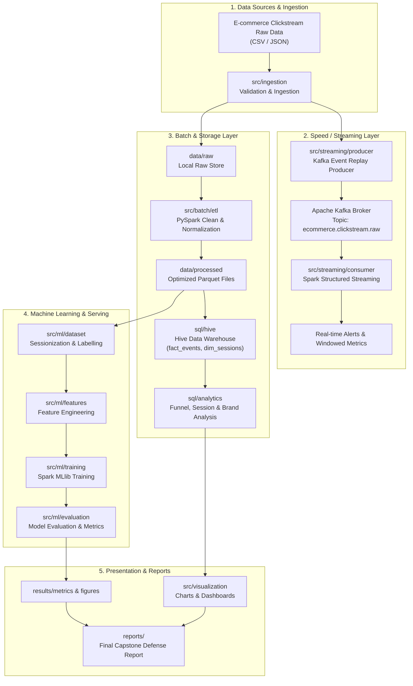

# Kiến Trúc Hệ Thống (System Architecture)

## 1. Tổng Quan Dự Án
Dự án **E-commerce Big Data Capstone** xây dựng một hệ thống xử lý dữ liệu lớn (Big Data Pipeline) toàn diện cho luồng sự kiện clickstream của sàn thương mại điện tử. Hệ thống kết hợp cả xử lý theo lô (Batch Processing) và xử lý luồng thời gian thực (Stream Processing), hỗ trợ phân tích hành vi người dùng, phễu chuyển đổi (conversion funnel), và mô hình học máy (Machine Learning) dự đoán ý định mua hàng.

---

## 2. Mô Hình Kiến Trúc (Architecture Overview)

Hệ thống được thiết kế theo mô hình **Hybrid / Lambda Architecture**, gồm 4 tầng chính:

---

## 3. Các Thành Phần Chi Tiết

### 3.1. Ingestion (`src/ingestion/`)
- Kiểm tra tính toàn vẹn (schema validation), kiểm tra định dạng và nạp dữ liệu thô ban đầu.
- Ghi nhận metadata về kích thước tập dữ liệu, số bản ghi và phân vùng dự kiến.

### 3.2. Batch Processing Layer (`src/batch/`)
- **`etl/`**: PySpark ETL pipeline thực hiện làm sạch dữ liệu (xử lý giá trị thiếu, ép kiểu dữ liệu timestamp, loại bỏ duplicate), chuẩn hóa và lưu trữ dưới định dạng Parquet nén (Snappy/ZSTD) có phân vùng (`partitionBy: year, month, event_type`).
- **`analytics/`**: Phân tích tổng hợp hiệu năng xử lý, benchmark tốc độ giữa các định dạng (CSV vs Parquet) và tài nguyên tính toán.

### 3.3. Streaming Layer (`src/streaming/`)
- **`producer/`**: Giả lập phát lại (playback) dữ liệu clickstream theo timestamp thực tế hoặc gia tốc thời gian gửi vào Apache Kafka.
- **`consumer/`**: Spark Structured Streaming đọc từ Kafka topic, thực hiện tính toán cửa sổ trượt (sliding / tumbling window) để phát hiện xu hướng giỏ hàng và bất thường.

### 3.4. SQL & Data Warehouse Layer (`sql/`)
- **`hive/`**: Chứa DDL tạo cơ sở dữ liệu, bảng ngoại vi (external table), bảng nội vi (managed table), và cấu hình partition cho Apache Hive.
- **`analytics/`**: Các truy vấn SQL phân tích nghiệp vụ:
  - Phân tích phễu chuyển đổi: `view` -> `cart` -> `purchase`.
  - Phân tích phiên truy cập (Sessionization): độ dài phiên, số sự kiện trung bình trên mỗi phiên.
  - Phân tích thương hiệu (Brand) và danh mục (Category) có tỷ lệ chuyển đổi cao nhất.

### 3.5. Machine Learning Layer (`src/ml/`)
- **`dataset/`**: Tổng hợp dữ liệu cấp phiên (Session-level dataset) và gán nhãn dự đoán (`is_purchased`: 0/1).
- **`features/`**: Trích xuất đặc trưng hành vi trước thời điểm quyết định (thời gian xem, số lượng mặt hàng thêm vào giỏ, độ đa dạng danh mục, thời điểm trong ngày).
- **`training/`**: Huấn luyện các mô hình phân loại với Spark MLlib (Logistic Regression, Random Forest, GBTClassifier) có Cross-Validation.
- **`evaluation/`**: Đánh giá bằng ROC-AUC, PR-AUC, F1-Score và lưu kết quả vào `results/metrics/`.

### 3.6. Visualization & Reporting (`src/visualization/`, `reports/`)
- Tạo các biểu đồ thống kê chất lượng cao cho báo cáo đồ án.
- Cung cấp dashboard (Streamlit / Dash / Grafana) nếu được kích hoạt.
- Toàn bộ kết quả thử nghiệm được lưu vết rõ ràng phục vụ việc bảo vệ đồ án tốt nghiệp.
