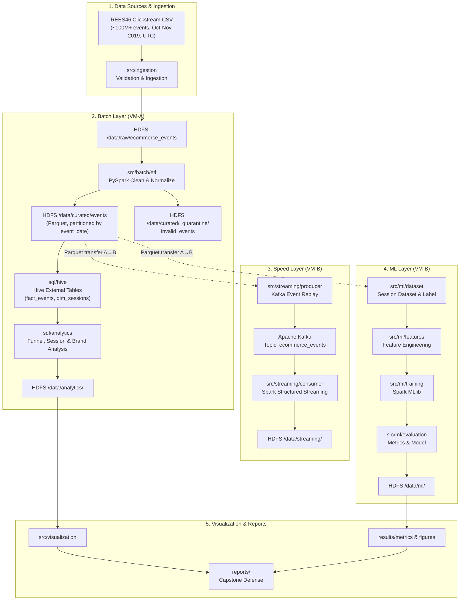

# Kiến Trúc Hệ Thống – E-Commerce Clickstream Big Data Pipeline

## 1. Tổng Quan

Dự án xây dựng hệ thống xử lý dữ liệu lớn cho luồng sự kiện clickstream thương mại điện tử REES46 (~100M+ sự kiện, Oct–Nov 2019).

Kiến trúc theo mô hình **Lambda Architecture rút gọn**, kết hợp ba tầng xử lý:

- **Batch Layer**: Xử lý hàng loạt với Apache Spark trên HDFS.
- **Speed Layer**: Xử lý luồng với Kafka + Spark Structured Streaming (phát lại dữ liệu lịch sử).
- **ML Layer**: Dự đoán hành vi người dùng với Spark MLlib.

> **Lưu ý:**
> - Tầng Streaming sử dụng dữ liệu lịch sử phát lại (history replay), KHÔNG phải sự kiện trực tiếp từ website.
> - Hệ thống chưa có Serving Layer hợp nhất kết quả batch và streaming. Kết quả mỗi tầng được lưu độc lập trên HDFS.

---

## 2. Kiến Trúc Hai VM

Dự án triển khai trên **hai VM độc lập**, mỗi VM có HDFS riêng:

```text
┌─────────────────────────────────┐     ┌─────────────────────────────────┐
│          VM-A (Data)            │     │        VM-B (Stream & ML)       │
│                                 │     │                                 │
│  HDFS-A (NameNode riêng)        │     │  HDFS-B (NameNode riêng)        │
│  ├── /data/raw/                 │     │  ├── /data/curated/ (từ A)      │
│  ├── /data/curated/             │     │  ├── /data/streaming/           │
│  ├── /data/analytics/           │     │  ├── /data/ml/                  │
│  └── /data/metadata/            │     │  └── /data/metadata/            │
│                                 │     │                                 │
│  Ingestion → ETL → Hive →      │     │  Kafka Producer → Streaming →   │
│  Batch Analytics → Benchmark    │     │  ML Pipeline → Demo             │
│                                 │     │                                 │
└────────────┬────────────────────┘     └─────────────────────────────────┘
             │                                       ▲
             │  Parquet export (Shared Folder / SCP)  │
             └───────────────────────────────────────┘
```

- Hai VM dùng **cùng quy ước đường dẫn HDFS** nhưng **không chia sẻ NameNode**.
- Git Repository dùng chung trên GitHub.
- Dữ liệu HDFS **không được đồng bộ qua GitHub**.

---

## 3. Sơ Đồ Kiến Trúc Tổng Thể



---

## 4. Chi Tiết Từng Tầng

### 4.1. Ingestion (`src/ingestion/`)

| Thành phần | Chi tiết |
|---|---|
| Nguồn dữ liệu | REES46 E-Commerce Clickstream (Kaggle) |
| Định dạng gốc | CSV (~100M+ sự kiện) |
| Khoảng thời gian | October – November 2019 |
| Timezone | UTC |
| Đích | HDFS `/data/raw/ecommerce_events` |

### 4.2. Batch Processing (`src/batch/`)

- **ETL** (`src/batch/etl/`): Làm sạch, chuẩn hóa kiểu dữ liệu, khử trùng lặp.
  - Dữ liệu sạch → `/data/curated/events` (Parquet, partitioned by `event_date` UTC).
  - Dữ liệu lỗi → `/data/curated/_quarantine/invalid_events`.
- **Hive** (`sql/hive/`): Bảng external trỏ vào Parquet trên HDFS.
- **Analytics** (`src/batch/analytics/`, `sql/analytics/`): Phân tích phễu chuyển đổi, session, product performance.
- **Benchmark** (`results/benchmark/`): Đo hiệu năng CSV vs Parquet.

### 4.3. Streaming (`src/streaming/`)

- **Producer** (`src/streaming/producer/`): Đọc Parquet curated, phát lại sự kiện lịch sử vào Kafka topic theo thứ tự thời gian.
- **Consumer** (`src/streaming/consumer/`): Spark Structured Streaming đọc Kafka, tính toán chỉ số theo cửa sổ thời gian, ghi kết quả vào HDFS `/data/streaming/`.
- **Lưu ý**: Đây là streaming dữ liệu lịch sử phát lại, KHÔNG phải sự kiện trực tiếp từ website.

### 4.4. Machine Learning (`src/ml/`)

- **Input**: Parquet curated từ Batch Layer.
- **Dataset** (`src/ml/dataset/`): Tạo dataset cấp phiên, gán nhãn `is_purchased`.
- **Features** (`src/ml/features/`): Trích xuất đặc trưng trước prediction point (tránh data leakage).
- **Training** (`src/ml/training/`): Spark MLlib, chia train/test theo thời gian (time-based split).
- **Evaluation** (`src/ml/evaluation/`): AUC-ROC, F1-score, Precision, Recall.
- **Output**: Model và metrics trên HDFS `/data/ml/`.

### 4.5. Visualization & Reporting (`src/visualization/`, `reports/`)

- Biểu đồ tĩnh (Matplotlib/Seaborn) cho báo cáo.
- Dashboard tương tác nếu nhóm triển khai.
- Kết quả thử nghiệm lưu vết phục vụ bảo vệ đồ án.

---

## 5. Đường Dẫn HDFS Thống Nhất

Cả hai VM sử dụng cùng cấu trúc đường dẫn logic (theo HDFS của Người A):

```text
/data/
├── raw/
│   └── ecommerce_events/              # Dữ liệu thô CSV đã nạp
├── curated/
│   ├── events/                        # Parquet sạch (partitioned by event_date)
│   └── _quarantine/
│       └── invalid_events/            # Bản ghi không hợp lệ
├── analytics/
│   ├── conversion_funnel/
│   ├── session_summary/
│   └── product_performance/
├── streaming/
│   ├── events/
│   ├── aggregations/
│   └── checkpoints/
├── ml/
│   ├── features/
│   │   └── session_features/
│   ├── datasets/
│   │   ├── train/
│   │   └── test/
│   ├── models/
│   └── evaluation/
└── metadata/
    ├── manifests/
    └── quality_reports/
```

---

## 6. Luồng Dữ Liệu End-to-End

1. **Nạp dữ liệu**: CSV (REES46) → HDFS raw (VM-A).
2. **ETL**: Raw → Clean/Validate → Curated Parquet + Quarantine (VM-A).
3. **Hive**: Tạo external table trỏ vào curated Parquet (VM-A).
4. **Analytics**: Truy vấn Hive/Spark SQL → Kết quả analytics trên HDFS (VM-A).
5. **Chuyển dữ liệu**: Curated Parquet từ VM-A → VM-B (Shared Folder / SCP).
6. **Streaming**: Curated Parquet → Kafka Producer → Kafka → Spark Streaming → HDFS streaming (VM-B).
7. **ML**: Curated Parquet → Session Features → Train/Test Split → MLlib → Model + Metrics (VM-B).

---

## 7. Công Nghệ Sử Dụng

| Thành phần | Công nghệ |
|---|---|
| Distributed Storage | HDFS (Hadoop Distributed File System) |
| Batch Processing | Apache Spark (PySpark) |
| Data Warehouse | Apache Hive |
| Message Broker | Apache Kafka |
| Stream Processing | Spark Structured Streaming |
| Machine Learning | Spark MLlib |
| Ngôn ngữ chính | Python / PySpark |
| Quản lý mã nguồn | Git + GitHub |
