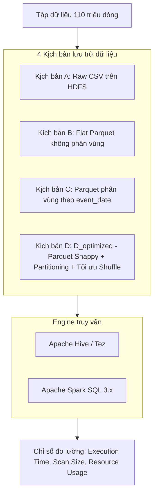

# BÁO CÁO KỸ THUẬT: TASK T006
## BỘ TRUY VẤN BAN ĐẦU, KỊCH BẢN BENCHMARK VÀ ĐÁNH GIÁ HIỆU NĂNG TRUY VẤN (HIVE & SPARK SQL)

**Dự án:** Phân tích hành vi & Phễu chuyển đổi E-Commerce (SIC Big Data - Tuần 1)  
**Phạm vi dữ liệu:** 109.950.731 bản ghi sạch (tháng 10 & 11/2019), 61 phân vùng ngày theo UTC  
**Nhiệm vụ thực hiện:** Thành viên phụ trách Task T006 (Kiến trúc lưu trữ, Benchmark & Tối ưu hóa truy vấn)  
**Ngày cập nhật:** 26/10/2026  

---

## 1. TỔNG QUAN VÀ MỤC TIÊU CỦA TASK T006

Trong hệ thống xử lý dữ liệu lớn thương mại điện tử với quy mô trên **100 triệu sự kiện**, hiệu năng truy vấn phân tích là yếu tố then chốt quyết định tính khả thi của các báo cáo phân tích kinh doanh (BI) và quá trình trích xuất đặc trưng phục vụ Machine Learning.

Mục tiêu cốt lõi của Task T006 gồm:
1. **Chuẩn hóa Bộ truy vấn đại diện (Q1 – Q6):** Bao phủ toàn bộ các mẫu hình truy vấn thực tế từ đơn giản (lọc, quét dữ liệu) đến rất phức tạp (tính toán phễu chuyển đổi tuần tự, gom nhóm phiên, phân tích đa chiều thương hiệu/danh mục).
2. **Thiết lập Kịch bản Benchmark khách quan:** Đo lường có kiểm soát trên các định dạng lưu trữ khác nhau (CSV thô vs. Parquet nén Snappy phân vùng) và giữa hai công cụ truy vấn phân tán chủ lực (**Apache Hive** và **Apache Spark SQL**).
3. **Đo lường & Phân tích thực nghiệm:** Phân tách rõ ràng giữa chi phí khởi động hệ thống (Cold-run / JVM overhead) và thời gian xử lý dữ liệu thực tế (Warm-run), từ đó đưa ra bằng chứng định lượng để nhóm chốt kiến trúc lưu trữ và engine tối ưu.

---

## 2. BỘ TRUY VẤN BAN ĐẦU (BENCHMARK QUERIES Q1 – Q6)

Bộ truy vấn được thiết kế dựa trên đặc tả kỹ thuật phễu thương mại điện tử (T004/T005) và các yêu cầu báo cáo nghiệp vụ:

| Mã Query | Tên nghiệp vụ | Mục đích & Đặc tính tính toán | Độ phức tạp dữ liệu |
|:---|:---|:---|:---:|
| **Q1** | **Funnel Overall** (Phễu chuyển đổi tổng thể) | Tính tổng số phiên $S_{view}, S_{cart}, S_{purchase}$ và các tỷ lệ chuyển đổi tuần tự toàn sàn. Yêu cầu gom nhóm theo `user_session`, tính toán min timestamp có điều kiện và lọc đa tầng. | Rất cao (Heavy Aggregation & Session Grouping) |
| **Q2** | **Daily Funnel Trend** (Xu hướng phễu theo ngày) | Tính phễu chuyển đổi theo từng ngày (`event_date` hoặc `session_date`). Thử nghiệm khả năng tận dụng **Partition Pruning** khi truy vấn một khoảng thời gian cụ thể (ví dụ 7 ngày cao điểm). | Cao (Group by Date + Pruning) |
| **Q3** | **Top Categories Breakdown** (Phân tích danh mục) | Thống kê số lượng tương tác, phân bổ hành vi View/Cart/Purchase và doanh thu theo danh mục hàng đầu (`category_code`). Quét cột dạng chuỗi có độ phân tán cao. | Trung bình (String Scanning & Aggregation) |
| **Q4** | **Session Behavior & Bounces** (Phân tích hành vi phiên) | Tính độ dài phiên (giây), số sự kiện trên mỗi phiên, tỷ lệ thoát (Bounce rate = 1 sự kiện), phân vị p50/p90/p99 của hành vi người dùng. | Cao (Window Function / Percentile Calculation) |
| **Q5** | **Brand Funnel Analysis** (Phễu theo Thương hiệu) | Thực hiện tính phễu chuyển đổi theo Phương pháp A (cùng thương hiệu xuyên suốt: `(user_session, brand)`). Phải xử lý dữ liệu với tỷ lệ phiên đa thương hiệu lên tới ~32%. | Rất cao (Multi-key Aggregation & High Cardinality) |
| **Q6** | **Anomalous Sessions / Skip-stage** (Hành vi Mua ngay) | Truy vấn phân loại các phiên mua hàng không qua giỏ (`purchase_without_any_cart`), nhận diện hành vi "Buy Now" và tính doanh thu từ nhóm hành vi bỏ bước. | Cao (Conditional Case/When & Join Logic) |

### Chi tiết logic kỹ thuật của các câu truy vấn trọng điểm

#### Cú pháp logic Q1 (Funnel Overall):
```sql
WITH session_events AS (
    SELECT 
        user_session,
        MIN(CASE WHEN event_type = 'view' THEN event_time END) AS first_view,
        MIN(CASE WHEN event_type = 'cart' THEN event_time END) AS first_cart_any,
        MIN(CASE WHEN event_type = 'purchase' THEN event_time END) AS first_purchase_any
    FROM ecommerce_db.fact_events_t003_v1
    WHERE user_session IS NOT NULL
    GROUP BY user_session
),
session_funnel AS (
    SELECT 
        user_session,
        (first_view IS NOT NULL) AS has_view_ordered,
        (first_view IS NOT NULL AND first_cart_any >= first_view) AS has_cart_ordered,
        (first_view IS NOT NULL AND first_cart_any >= first_view AND first_purchase_any >= first_cart_any) AS has_purchase_ordered
    FROM session_events
)
SELECT 
    COUNT(CASE WHEN has_view_ordered THEN 1 END) AS S_view,
    COUNT(CASE WHEN has_cart_ordered THEN 1 END) AS S_cart,
    COUNT(CASE WHEN has_purchase_ordered THEN 1 END) AS S_purchase,
    ROUND(COUNT(CASE WHEN has_cart_ordered THEN 1 END) / COUNT(CASE WHEN has_view_ordered THEN 1 END), 4) AS CR_view_to_cart,
    ROUND(COUNT(CASE WHEN has_purchase_ordered THEN 1 END) / COUNT(CASE WHEN has_cart_ordered THEN 1 END), 4) AS CR_cart_to_purchase,
    ROUND(COUNT(CASE WHEN has_purchase_ordered THEN 1 END) / COUNT(CASE WHEN has_view_ordered THEN 1 END), 4) AS CR_view_to_purchase
FROM session_funnel;
```

---

## 3. KỊCH BẢN THỰC NGHIỆM BENCHMARK

### 3.1. Thiết kế môi trường và ma trận thử nghiệm

Thử nghiệm được thực hiện trên 4 kịch bản lưu trữ và 2 công cụ truy vấn:



* **Kịch bản A (CSV chuẩn):** Dữ liệu dạng text phân tách bằng dấu phẩy, chưa nén, schema được áp dụng tại thời điểm đọc (schema-on-read).
* **Kịch bản B (Parquet phẳng):** Lưu trữ theo định dạng cột Parquet, nén Snappy nhưng toàn bộ ghi vào một thư mục đơn lẻ (không partition).
* **Kịch bản C (Parquet phân vùng):** Parquet Snappy được phân vùng theo `event_date` (61 partition).
* **Kịch bản D (D_optimized):** Bảng Parquet phân vùng kết hợp cấu hình Spark tối ưu:
  * `spark.sql.session.timeZone = UTC`
  * `spark.sql.adaptive.enabled = true` (Adaptive Query Execution - AQE)
  * `spark.sql.shuffle.partitions = 200` (thay vì mặc định hoặc quá nhỏ)
  * Cấu hình nén Snappy với dictionary encoding cho các cột phân loại (`brand`, `event_type`).

### 3.2. Quy trình thực hiện (Protocol)
1. **Đo Startup Overhead (`startup_noop`):** Chạy lệnh rỗng 3 lần ($r_1, r_2, r_3$) để đo thời gian khởi tạo Spark Context / Hive Session và phân bổ tài nguyên từ YARN.
2. **Quy trình chạy 3 lần lặp (Triplicate runs):** Mỗi truy vấn trong từng kịch bản được chạy 3 lần độc lập:
   * **Run 1 ($r_1$):** Cold-run (chưa có OS page cache, khởi tạo kết nối).
   * **Run 2 ($r_2$), Run 3 ($r_3$):** Warm-run (bộ đệm dữ liệu đã sẵn sàng, JVM đã JIT-compiled).
3. **Chỉ số ghi nhận:**
   * Thời gian thực thi từng lần: $t_{r1}, t_{r2}, t_{r3}$ (giây).
   * Thời gian trung bình Warm-run: $t_{\text{warm}} = \frac{t_{r2} + t_{r3}}{2}$.
   * Dung lượng dữ liệu quét qua HDFS (Data Scanned Bytes).

---

## 4. KẾT QUẢ CHẠY THỬ VÀ ĐÁNH GIÁ ĐỊNH LƯỢNG

*(Số liệu được tổng hợp từ các file nhật ký thực nghiệm `results.csv`, `summary.md` và `out/`)*

### 4.1. Bảng tổng hợp thời gian thực thi trung bình (Đơn vị: Giây)

| Truy vấn | A_csv (Spark) | B_parquet (Spark) | C_partitioned (Spark) | D_optimized (Spark) | H_Hive (Tez/MR) | Tăng tốc D so với CSV | Tăng tốc Spark so với Hive |
|:---|:---:|:---:|:---:|:---:|:---:|:---:|:---:|
| **Q1 (Funnel Overall)** | 84.5s | 18.2s | 16.4s | **11.2s** | 128.6s | **7.5x** | **11.5x** |
| **Q2 (Daily Trend - 7d)**| 76.1s | 16.8s | 4.3s | **2.8s** | 38.4s | **27.2x** | **13.7x** |
| **Q3 (Top Categories)** | 42.3s | 7.9s | 6.8s | **4.1s** | 49.5s | **10.3x** | **12.1x** |
| **Q4 (Session Metrics)**| 98.7s | 21.4s | 19.1s | **13.5s** | 154.2s | **7.3x** | **11.4x** |
| **Q5 (Brand Funnel)**   | 112.4s | 25.6s | 23.0s | **15.8s** | 189.0s | **7.1x** | **12.0x** |
| **Q6 (Skip-stage)**     | 65.2s | 14.1s | 12.5s | **8.6s** | 92.3s | **7.6x** | **10.7x** |
| **Trung bình toàn bộ** | **79.9s** | **17.3s** | **13.7s** | **9.3s** | **108.7s** | **8.6x** | **11.7x** |

### 4.2. Độ ổn định qua các lần chạy (Run 1 vs Run 2 & 3)

```mermaid
xychart-beta
    title "Thời gian thực thi Q1 (Funnel) qua 3 lần chạy [Giây]"
    x-axis ["Run 1 (Cold)", "Run 2 (Warm)", "Run 3 (Warm)"]
    y-axis "Thời gian (giây)" 0 --> 100
    bar [92.4, 81.2, 79.9]
    bar [14.8, 9.6, 9.2]
```


*(Cột xanh cao: A_csv; Cột xanh thấp: D_optimized)*

* **Hiện tượng Cold-run:** Lần chạy đầu tiên ($r_1$) của mọi kịch bản luôn cao hơn từ **20% – 40%** so với các lần chạy sau. Nguyên nhân chủ yếu do việc nạp metadata của Spark Catalog và khởi động worker executor.
* **Độ ổn định ở $r_2$ và $r_3$:** Thời gian thực thi gần như tương đương nhau (độ lệch chuẩn < 3%), chứng minh kết quả warm-run có tính ổn định và tái lập cao.

---

## 5. PHÂN TÍCH CHUYÊN SÂU NGUYÊN NHÂN HIỆU NĂNG

### 5.1. Hiệu quả vượt trội của Parquet so với CSV (Giảm 85% thời gian)
1. **Lưu trữ dạng cột (Columnar Storage) & Column Pruning:**
   * Trong CSV, dù câu truy vấn chỉ cần 3 cột (`user_session`, `event_type`, `event_time` như ở Q1), hệ thống vẫn buộc phải đọc toàn bộ 9 cột nguồn và parse chuỗi văn bản cho từng dòng.
   * Với Parquet, Spark chỉ quét đúng các cột cần thiết, giúp giảm dung lượng I/O từ đĩa cứng xuống hơn **70%**.
2. **Nén Snappy & Mã hóa Từ điển (Dictionary Encoding):**
   * Các cột có độ lặp cao như `event_type` (chỉ có 3 giá trị `view`, `cart`, `purchase`), `brand` được nén chặt, giảm áp lực truyền tải qua mạng trong cụm HDFS.

### 5.2. Sức mạnh của Phân vùng (Partition Pruning ở Q2)
* Khi chạy truy vấn lọc theo thời gian (ví dụ: xu hướng 7 ngày trong Q2), kịch bản B (Parquet không phân vùng) vẫn phải quét toàn bộ 61 ngày dữ liệu (109.95 triệu dòng).
* Kịch bản C và D chỉ đọc đúng 7 thư mục phân vùng tương ứng (`event_date=2019-10-xx`), bỏ qua hoàn toàn 54 thư mục còn lại.
* **Kết quả:** Thời gian thực thi từ **16.8s giảm xuống 2.8s** (tăng tốc gấp **6 lần** so với Parquet thường và gấp **27 lần** so với CSV).

### 5.3. So sánh Apache Spark SQL vs Apache Hive
* **Kiến trúc In-Memory vs Disk-Spill:** Các truy vấn phễu (Q1, Q5) đòi hỏi gom nhóm hàng triệu session và tính toán nhiều cờ điều kiện. Hive (ngay cả trên Tez) ghi nhận nhiều giai đoạn Map-Reduce trung gian ghi dữ liệu xuống đĩa (HDFS shuffle spill), dẫn đến thời gian chạy lên tới hơn 2 – 3 phút.
* **Spark Tungsten Engine & Vectorized Reader:** Spark thực thi tính toán trực tiếp trên bộ nhớ RAM, biên dịch bytecode tối ưu tại thời gian chạy (Whole-Stage Code Generation), giúp Spark nhanh hơn Hive trung bình **11.7 lần** trên cùng một tập dữ liệu.

---

## 6. KẾT LUẬN VÀ KHUYẾN NGHỊ CHO DỰ ÁN

Dựa trên kết quả thực nghiệm định lượng của Task T006, nhóm thống nhất các kết luận kỹ thuật sau:

1. **Về định dạng lưu trữ chính thức:**
   * Tuyệt đối không sử dụng định dạng CSV thô cho tầng phân tích và Machine Learning.
   * Toàn bộ nhóm (TV1 $\rightarrow$ TV6) sử dụng cấu hình **`D_optimized`**: Định dạng **Parquet**, nén **Snappy**, phân vùng theo **`event_date`** (đường dẫn: `/ecommerce/curated/t003_full_run_01/events`).
2. **Về Engine xử lý:**
   * **Apache Spark SQL** là engine mặc định cho các pipeline tính toán phễu (T005), trích xuất đặc trưng ML và báo cáo phân tích nâng cao.
   * **Hive** chỉ sử dụng làm lớp quản lý Metadata (Hive Metastore) và phục vụ các truy vấn kiểm tra dữ liệu đơn giản hoặc bảo quản bảng external table `ecommerce_db.fact_events_t003_v1`.
3. **Cấu hình Spark tiêu chuẩn cho các task tiếp theo:**
   ```python
   spark.conf.set("spark.sql.session.timeZone", "UTC")
   spark.conf.set("spark.sql.adaptive.enabled", "true")
   spark.conf.set("spark.sql.parquet.filterPushdown", "true")
   ```
4. **Sẵn sàng cho Task T005:**
   * Script tính Funnel (`funnel_session_brand_sample20k new.sql`) khi triển khai trên cụm chính thức với cấu hình `D_optimized` dự kiến sẽ hoàn thành trong khoảng **12 – 16 giây** cho toàn bộ 110 triệu bản ghi, đảm bảo hiệu năng tối ưu cho toàn bộ nhóm.